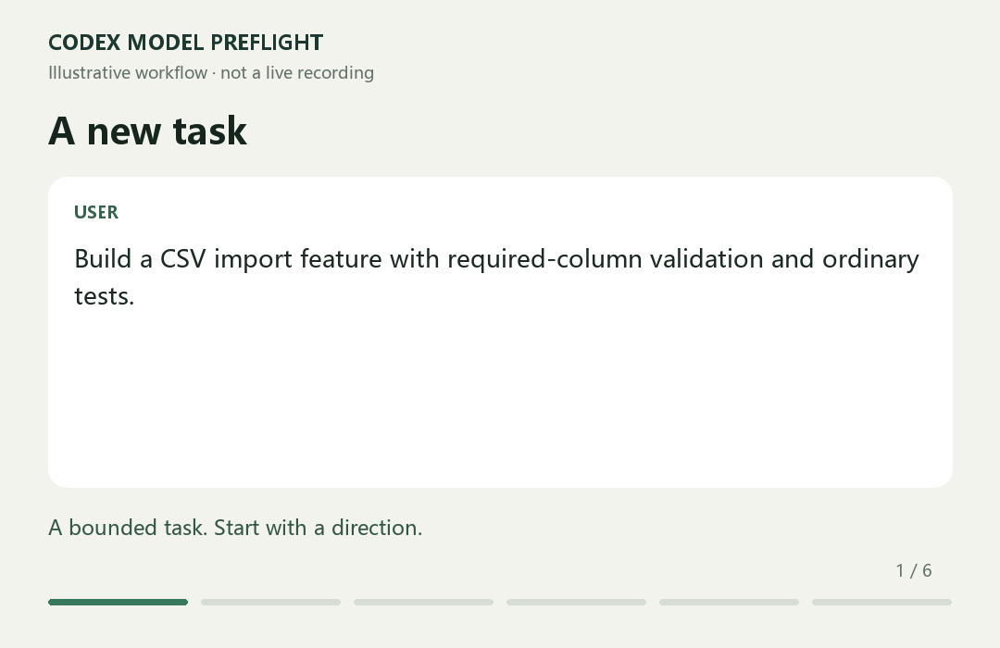

# Codex Model Preflight

**A brief, grounded model recommendation before a substantial task.**

**v0.1.0 · Early preview · Codex-focused**

[简体中文](README.zh-CN.md) · [12 public cases](docs/cases.md) · [Install](docs/install.md) · [Behavior](docs/behavior.md)

Want to try it without a terminal? [Download the friend trial ZIP](downloads/codex-model-preflight-v0.1.0-friends.zip), extract it, and open the included `Codex试用项目` folder in Codex. It includes the project-scoped skill, a fictional CSV task, a Chinese quick-start guide, and a feedback form. This does not change global settings.



```text
Routine · GPT-6.1 Sol / Medium / Standard, if available.
Why: a bounded feature with clear requirements and ordinary tests.
Escalate if: conflicting requirements or a difficult root cause emerges.
```

Choose the settings yourself, then say “continue”. Already chose? It proceeds. Small follow-ups? It stays quiet.

## Why install this instead of generating your own?

You can write an equivalent skill yourself. This package saves the setup and review work with:

- A ready-to-use policy: one selection step per substantial task, accepted continuations, and a no-pause option.
- A dated, sourced model guide, separate from the core behavior.
- Twelve inspectable cases, including situations where it should stay quiet.
- Installation, removal, release notes, and a public place to report wrong advice.

These are inspectable package features, not proof of better recommendations than a self-written skill. **No percentage savings, optimal-model guarantee, or independent accuracy benchmark is claimed.** Preflight itself also uses context and inference.

## Try it

From the project where you want to try the skill, run:

```sh
npx skills add ganga321frank/codex-model-preflight --skill codex-model-preflight -a codex --copy
```

This third-party installer requires Node.js. Inspect its proposed location and confirm the install. Prefer project scope for your first trial. There is also a [manual install without Node.js](docs/install.md#manual-install).

Start a new Codex chat in that project and try:

```text
Use $codex-model-preflight. Build a small CSV import feature with validation and tests.
```

For automatic consideration at substantial task boundaries, merge the short [AGENTS.md snippet](docs/agents-snippet.md) into the target project's existing instructions. **Installation alone does not guarantee invocation on every task.** Skill matching and instruction following remain model-dependent. This is a chat message, not a system popup.

## Scope and evidence

Three classes: Simple, Routine, Complex. One starting configuration and a reason. Standard speed by default. No API keys, runtime daemon, account-log scanner, automatic model switching, or telemetry code in the skill. The optional third-party installer has its own telemetry policy.

The installed skill contains **three core text files plus its license**. Examples and promotional assets stay in this repository and are not needed during recommendations. See [validation status](docs/validation.md) for the exact checks performed and their limits.

## Contribute

Report the task, previous choice, recommendation, and what you expected using the issue template. Use fictional or sanitized inputs. A better task distinction is more useful than another unconditional rule. When model names or controls change, update the [dated guide](skills/codex-model-preflight/references/model-guide.md) and relevant cases together.

Independent community project; not affiliated with OpenAI. [MIT](LICENSE).

[v0.1.0 release notes](docs/release-v0.1.0.md)
