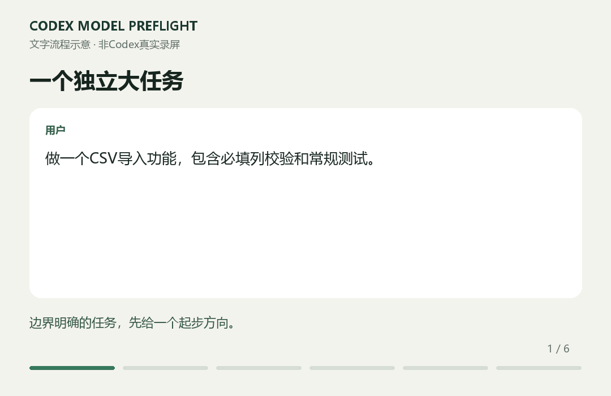

# Codex Model Preflight

**大任务开始前，给你一次简短、有依据的模型与推理档位建议。**

**v0.1.0 · 试用预览版 · 优先支持 Codex**

[English](README.md) · [12 个公开案例](docs/cases.md) · [安装与卸载](docs/install.md) · [使用约定](docs/behavior.md)

想先直接试用？[下载朋友试用包](downloads/codex-model-preflight-v0.1.0-friends.zip)，解压后用 Codex 打开其中的“Codex试用项目”文件夹。包内附中文说明、虚构 CSV 任务和反馈表；不需要终端，不改全局配置。[怎样试用](docs/try-it.zh-CN.md)



```text
常规任务 · 建议 GPT-6.1 Sol / Medium / Standard（如可用）。
理由：功能边界明确，主要是实现与测试。
升级条件：出现冲突需求或难定位的根因时再评估。
```

你在选择器里调整后回复“继续”即可。已经选定本轮设置，直接沿用；普通追问不反复提醒。

## 为什么不自己让 AI 生成一个？

你完全可以自行生成同类技能。这份发布包帮你省去整理与检查的工作：

- **行为约定现成**：大任务暂停一次，接受后继续，也能说“不要暂停”。
- **模型建议可追溯**：独立对应表，标注核对日期与官方依据。
- **公开案例可检查**：12 个示例同时覆盖应该提醒和应该安静的情况。
- **后续修改有记录**：安装、卸载、版本说明与问题反馈入口一起提供。

这些是可检查的产品特征。我们尚未实证证明它比自行生成的技能更准确，也不承诺固定省额度比例或“最优”选型。提示本身也有上下文和推理开销。

## 开始使用

在准备试用技能的项目目录打开终端：

```sh
npx skills add ganga321frank/codex-model-preflight --skill codex-model-preflight -a codex --copy
```

这条命令使用第三方 Skills CLI，需要 Node.js。确认安装范围和路径，首次建议选项目范围。也可以[手动安装，不需要 Node.js](docs/install.md#manual-install)。

在目标项目新开聊天，试一句：

```text
请用 $codex-model-preflight：做一个带校验和测试的 CSV 导入功能。
```

希望每个独立大任务开始时都考虑调用，可把[短触发规则](docs/agents-snippet.md)合并到现有项目 AGENTS.md。**装好技能不代表每次必然触发**；自动选择和指令执行仍取决于模型。这是聊天文字提醒，不是系统弹窗。

## 它保持多简单？

简单、常规、复杂三档；给一个起步配置、一句理由和必要的升级条件，默认 Standard 速度。安装到 Codex 的技能只有 **3 个核心文本文件及许可证**。不需要 API Key，不包含后台服务、账户日志扫描、自动切换或遥测代码；可选第三方安装器有自己的遥测政策。

案例和宣传素材留在仓库，不参与日常分档。具体检查结果见[验证说明](docs/validation.md)，案例走查不等于独立准确率测试。

## 参与改进

用 Issue 模板提供脱敏任务、此前选择、实际推荐和预期。我们优先修正任务区分与触发行为。模型或界面档位变化时，同时更新[模型对应表](skills/codex-model-preflight/references/model-guide.md)、受影响的案例与版本记录。公开反馈便于维护，不代表实时更新承诺。

独立社区项目，与 OpenAI 无隶属关系。[MIT 许可证](LICENSE)。

[v0.1.0 发布说明](docs/release-v0.1.0.md)
